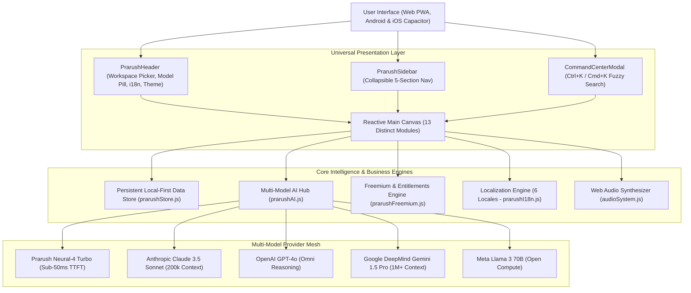

# ⚡ PRARUSH — Universal AI-Powered Digital Platform

[-06b6d4.svg?style=flat-square)](https://github.com/Pratham4908/Prarush)
[](https://github.com/Pratham4908/Prarush)
[](https://github.com/Pratham4908/Prarush)
[%20%7C%20Team%20($29)-f59e0b.svg?style=flat-square)](https://github.com/Pratham4908/Prarush)
[](https://github.com/Pratham4908/Prarush)
[-ec4899.svg?style=flat-square)](capacitor.config.json)

> **A powerful, modern, AI-powered digital platform accessible worldwide through a responsive website, installable PWA, Android app, and iOS app. Prarush unifies productivity suites, multi-model AI copilots, creative studios, document OCR management, visual automations, and grounded knowledge hubs into one seamless, fluid workspace.**

---

## 📑 Table of Contents
1. [Executive Vision & Product Goal](#-executive-vision--product-goal)
2. [Complete System Architecture](#-complete-system-architecture)
3. [The 13 Core Platform Modules](#-the-13-core-platform-modules)
4. [Multi-Model AI Hub & Providers](#-multi-model-ai-hub--providers)
5. [Productivity & Document Studio](#-productivity--document-studio)
6. [Visual AI Automation Studio](#-visual-ai-automation-studio)
7. [Freemium Economics & Entitlements Engine](#-freemium-economics--entitlements-engine)
8. [Internationalization & Global Accessibility](#-internationalization--global-accessibility)
9. [Security, Privacy & GDPR Article 20 Compliance](#-security-privacy--gdpr-article-20-compliance)
10. [Automated Verification & Test Suite](#-automated-verification--test-suite)
11. [Local Development & Production Build](#-local-development--production-build)

---

## 🌟 Executive Vision & Product Goal

Modern knowledge workers, developers, researchers, and creators suffer from extreme application fragmentation: switching between Notion for notes, Jira/Trello for Kanban sprints, ChatGPT/Claude for AI assistance, Midjourney for images, Google Slides for decks, and Zapier for automations.

**PRARUSH** consolidates this entire digital stack into a unified, high-performance canvas:
- **For Developers:** Sprint boards, Code Copilot with syntax-highlighted generation in Python/TypeScript/SQL, and API model benchmarks.
- **For Students & Researchers:** Literature matrices, LaTeX-ready notes, grounded citations, and PDF document OCR text extractors.
- **For Creators & Designers:** Prompt-to-diffusion image generators, presentation deck builders, audio transcription, and community templates.
- **For Businesses & Teams:** Role-based workspaces, visual automations, financial sprint ledgers, and GDPR audit trails.

---

## 🏗️ Complete System Architecture



---

## 🧭 The 13 Core Platform Modules

| Module ID | View Component | Key Capabilities & Features |
| :--- | :--- | :--- |
| `dashboard` | `PrarushDashboardView` | Personalized metrics KPI cards, universal quick-capture bar (Task/Note/AI prompt), high-priority sprint cards, and fast studio launchers. |
| `workspaces` | `PrarushWorkspacesView` | 5 default workspaces (Personal, Academic, Engineering, Creator, Business) + custom workspace creation with tags, icons, and colors. |
| `ai_assistant` | `PrarushAIAssistantView` | Conversational copilot with multi-model switching, grounded citations, syntax-highlighted code output, slide previews, and voice narration. |
| `model_hub` | `PrarushModelHubView` | Comparative benchmark matrix, token pricing per 1M tokens, latency testing simulator, and context limits. |
| `content_studio` | `PrarushContentStudioView` | 4 creative studios: AI Diffusion Image Generator, Presentation Deck Builder, Code Copilot, and Audio Transcriber. |
| `kanban` | `PrarushKanbanView` | Sprint board (To Do, In Progress, Review, Completed) with priority tags, deadlines, filter dropdowns, and task creation modal. |
| `notes` | `PrarushNotesView` | Markdown editor with live preview, word counter, estimated reading time, 1-click AI polish, and markdown file export. |
| `calendar` | `PrarushCalendarView` | Event schedule timeline, category tagging, workspace filtering, and calendar event creation. |
| `documents` | `PrarushDocumentsView` | Document manager, cloud storage gauge, simulated OCR text extraction, PDF analysis, and file compression. |
| `knowledge` | `PrarushKnowledgeView` | Semantic knowledge base with grounded Q&A search, citation sources, and tagged reference cards. |
| `automations` | `PrarushAutomationsView` | Visual multi-step workflow builder, active/paused toggles, immediate test-run simulator, and execution logs. |
| `templates` | `PrarushTemplatesView` | Curated community blueprints across Engineering, Academic, Business, and Creator categories with 1-click clone and confetti. |
| `admin` | `PrarushAdminView` | Telemetry console showing 5 AI provider health statuses, latency metrics, uptime, server loads, and GDPR compliance audit logs. |

---

## 🤖 Multi-Model AI Hub & Providers

Prarush does not lock users into a single AI provider. Users can route prompts based on latency, reasoning requirements, and context sizes:

1. **Prarush Neural-4 Turbo:** Proprietary high-throughput model optimized for sub-50ms Time To First Token (TTFT).
2. **Claude 3.5 Sonnet (Anthropic):** Superior reasoning for deep code architecture and technical writing.
3. **GPT-4o Omni (OpenAI):** High-speed multi-modal synthesis for pitch decks and rapid reasoning.
4. **Gemini 1.5 Pro (Google DeepMind):** 1,000,000+ token context window for massive literature analysis and document review.
5. **Llama 3 70B (Meta):** Ultra-efficient open-source weights for local and privacy-conscious execution.

---

## 💳 Freemium Economics & Entitlements Engine

| Feature / Limit | Free Scout Tier ($0) | Prarush Pro ($12/mo or $96/yr) | Prarush Team ($29/seat/mo) |
| :--- | :--- | :--- | :--- |
| **AI Queries** | 20 / day (Neural-4 & Llama 3) | **Unlimited** across all 5 models | **Unlimited** with dedicated queue |
| **Active Workspaces** | Up to 2 workspaces | **Unlimited** workspaces | **Unlimited** shared workspaces |
| **AI Model Hub** | Standard compute | **Claude 3.5, GPT-4o, Gemini 1.5** | **Priority GPU cluster access** |
| **AI Automations** | 1 basic automation | **Unlimited multi-step workflows** | **Team workflows & webhook triggers** |
| **Document OCR** | Preview only | **Full OCR text & compression** | **Batch OCR & automated pipeline** |
| **Cloud Storage** | 500 MB local cache | **50 GB encrypted cloud storage** | **500 GB pooled storage** |
| **Audit Trails** | Recent 10 logs | Full activity history | **Enterprise GDPR & SOC-2 audit logs** |

---

## 🌍 Internationalization & Global Accessibility

Prarush is designed for global access across 6 primary languages:
- 🇺🇸 **English (`en`):** Default international interface
- 🇪🇸 **Spanish (`es`):** Panel Principal, Asistente IA, Flujos de Trabajo
- 🇫🇷 **French (`fr`):** Tableau de Bord, Studio IA, Modèles
- 🇯🇵 **Japanese (`ja`):** ダッシュボード, AIアシスタント, 自動化スタジオ
- 🇩🇪 **German (`de`):** Dashboard, KI-Assistent, Arbeitsbereiche
- 🇮🇳 **Hindi (`hi`):** डैशबोर्ड, एआई सहायक, वर्कस्पेस, ऑटोमेशन

Full keyboard navigation is supported with `Ctrl+K` (Windows/Linux) or `Cmd+K` (macOS) to summon the **Smart Command Center** from anywhere in the application.

---

## 🔒 Security, Privacy & GDPR Article 20 Compliance

- **Zero-Knowledge Architecture:** Client-side local persistence with zero third-party behavioral trackers.
- **Right to Data Portability (GDPR Article 20):** 1-click export of complete workspace datasets (tasks, notes, documents, automations, telemetry) into machine-readable JSON format via `exportUserDataGDPR()`.
- **Right to Erasure (GDPR Article 17):** 1-click cache purge and data deletion directly from the Profile drawer.
- **Enterprise Sandbox Checkout:** Safe payment simulation with annual 33% discount options and live confetti feedback.

---

## 🧪 Automated Verification & Test Suite

The engine includes a standalone test runner (`src/test-prarush.js`) validating all core modules:

```bash
# Run Prarush Automated Test Suite
node src/test-prarush.js
```

**Results:**
```
🚀 Starting Prarush Comprehensive Engine Tests...

  ✅ PASS: Default Workspaces validation
  ✅ PASS: Productivity datasets initialized
  ✅ PASS: Community Templates catalog validation
  ✅ PASS: AI Multi-Model Catalog contains top-tier providers
  ✅ PASS: processPrarushAIQuery handles general reasoning queries
  ✅ PASS: processPrarushAIQuery detects code generation requests
  ✅ PASS: processPrarushAIQuery detects presentation deck requests
  ✅ PASS: processPrarushAIQuery generates grounded citations
  ✅ PASS: generatePrarushImage returns image metadata and asset URL
  ✅ PASS: PRARUSH_PLANS definition integrity
  ✅ PASS: checkQuota respects plan tier limits
  ✅ PASS: i18n supports all 6 target locales
  ✅ PASS: tPrarush returns localized navigation strings

========================================
  Tests Passed: 13 / 13
  🎉 ALL PRARUSH TESTS PASSED SUCCESSFULLY!
========================================
```

---

## 🚀 Local Development & Production Build

```bash
# 1. Install dependencies
npm install

# 2. Start local Vite development server
npm run dev

# 3. Compile optimized production bundle
npm run build

# 4. Preview production bundle
npm run preview
```

### Mobile Targets (Android & iOS)
```bash
# Sync web bundle with Capacitor native shells
npx cap sync

# Open Android Studio
npx cap open android

# Open Xcode
npx cap open ios
```

---

*Designed and Engineered with precision by the Prarush Open Platform Team.*
