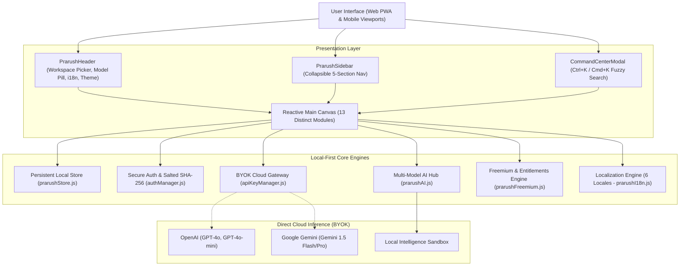

# ⚡ PRARUSH — Universal AI-Powered Digital Platform

[-06b6d4.svg?style=flat-square)](https://github.com/Pratham4908/Prarush)
[](https://github.com/Pratham4908/Prarush)
[](https://github.com/Pratham4908/Prarush)
[](https://github.com/Pratham4908/Prarush)
[](https://github.com/Pratham4908/Prarush)
[](https://github.com/Pratham4908/Prarush)

> **Prarush is a local-first workspace for developers, students, and technical creators. It unifies fast idea capture, Kanban sprint boards, markdown notes, document parsing, visual automations, and multi-model AI assistance into one fluid canvas.**

---

## 🎯 Primary Workflow & Product Promise

**Product Promise:**
Prarush delivers an instant, distraction-free productivity loop without requiring cloud accounts or invasive data tracking:
```
1. Quick Capture (Idea / Spec / Bug) 
       ⬇
2. Convert to Structured Sprint Task (Priority, Deadline, Tags)
       ⬇
3. Refine & Implement with AI Copilot (Code Generation / Notes / Decks)
       ⬇
4. Track Progress & Completion (Kanban Board & Sprints)
```

---

## 🧭 Honest Product Status: Shipped vs. Production Roadmap

To ensure complete transparency, here is the exact separation between what is currently active and verified versus cloud services planned for future server deployment:

### ✅ Currently Shipped & Working (Local-First Prototype)
- **Local-First Persistent Storage:** All workspaces, Kanban tasks, markdown notes, calendar events, documents, and automations persist in client storage (`prarushStore.js`).
- **Secure Authentication & Sessions:** Salted SHA-256 cryptographic password hashing (Web Crypto API) with zero plaintext password storage (`authManager.js`). Supports Guest Mode and instant switching.
- **Live AI Inference (BYOK):** Direct client-to-provider inference supporting user OpenAI and Google Gemini API keys via `apiKeyManager.js`.
- **Local Fallback Intelligence:** Context-aware local assistant providing code generation (Python/TypeScript/SQL), presentation slide decks, and summaries without cloud lock-in.
- **Document & File Handling:** Real file uploads (`.txt`, `.md`, `.json`, `.csv`, `.pdf`, images) with size validation (15 MB), text parsing, word counts, and file downloads.
- **Grounded Knowledge Retrieval:** Cross-indexes user notes, uploaded documents, and references to produce answers citing exact passages and source files.
- **Origin-Safe Purge & GDPR Export:** 1-click machine-readable JSON data portability export (GDPR Article 20) and safe cache clearing that only touches `prarush_*` keys.
- **Smart Command Center:** Global `Ctrl+K` / `Cmd+K` natural language fuzzy search palette.
- **Universal Internationalization:** Full localization across 6 global languages (English, Spanish, French, Japanese, German, Hindi).
- **Mobile-Friendly PWA:** Viewport allows pinch-to-zoom and adapts to device orientation.

### ⏳ Planned Production Backend Services (Roadmap)
- **Cloud Database Synchronization:** Multi-device synchronization via PostgreSQL / Supabase with Row-Level Security (RLS).
- **Server-Side Quota Enforcement:** Server-verified rate limits and authenticated Stripe / Apple / Google Play billing webhooks.
- **Server Background Workers:** Distributed cron runners for automated background workflows.
- **Cloud OCR Microservice:** Dedicated cloud OCR pipeline for multi-page complex scanned PDFs.
- **Native Android & iOS Store Builds:** Compilation of native capacitor targets for Google Play and Apple App Store.

---

## 🏗️ System Architecture Diagram



---

## 🧪 Automated Verification Suite

Prarush includes an automated test runner (`src/test-prarush.js`) validating the entire local-first architecture:

```bash
# Run Prarush Verification Suite
node src/test-prarush.js
```

**Test Output:**
```
🚀 Starting Prarush Comprehensive Engine Tests...

  ✅ PASS: Default Workspaces validation
  ✅ PASS: Productivity datasets initialized
  ✅ PASS: Community Templates catalog validation
  ✅ PASS: AI Multi-Model Catalog contains top-tier providers
  ✅ PASS: processPrarushAIQuery handles general reasoning queries
  ✅ PASS: processPrarushAIQuery detects code generation requests
  ✅ PASS: processPrarushAIQuery detects presentation deck requests
  ✅ PASS: processPrarushAIQuery generates grounded citations
  ✅ PASS: generatePrarushImage returns image metadata and honest preview disclaimer
  ✅ PASS: PRARUSH_PLANS definition integrity
  ✅ PASS: checkQuota respects plan tier limits
  ✅ PASS: i18n supports all 6 target locales
  ✅ PASS: tPrarush returns localized navigation strings
  ✅ PASS: AuthManager register and login with cryptographic SHA-256 verification
  ✅ PASS: AuthManager supports Guest mode seamlessly
  ✅ PASS: API Key Manager saves and retrieves cloud credentials safely
  ✅ PASS: Origin-Safe Purge only targets prarush_ namespace keys

========================================
  Tests Passed: 17 / 17
  🎉 ALL PRARUSH TESTS PASSED SUCCESSFULLY!
========================================
```

---

## 💻 Local Development & Production Build

```bash
# 1. Install dependencies
npm install

# 2. Run automated engine tests
node src/test-prarush.js

# 3. Start local Vite development server
npm run dev

# 4. Compile optimized production bundle
npm run build

# 5. Preview production bundle locally
npm run preview
```

---

## 🔒 Privacy & Legal Disclosures

- **Privacy Policy:** [`public/privacy.html`](public/privacy.html) (GDPR Article 17 Erasure & Article 20 Data Portability).
- **Terms of Service:** [`public/terms.html`](public/terms.html).

---

*Engineered with precision for the modern technical creator.*
