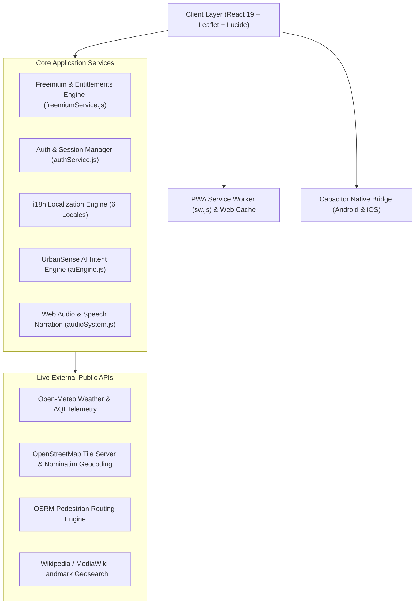

# 🏙️ City Life: Exploring, Experiencing & Navigating the Chaos We Call Home

[-06b6d4.svg?style=flat-square)](https://github.com/Pratham4908/Prarush)
[](https://github.com/Pratham4908/Prarush)
[](https://github.com/Pratham4908/Prarush)
[](https://github.com/Pratham4908/Prarush)
[](/public/privacy.html)
[-ec4899.svg?style=flat-square)](capacitor.config.json)

> **A production-grade, privacy-first, cross-platform smart city intelligence platform that unifies live scientific telemetry (Open-Meteo), OpenStreetMap geosearch, pedestrian SafeRoute navigation (OSRM), Wikipedia living heritage lore, crowdsourced citizen reports, and an autonomous AI copilot into a seamless freemium experience.**

---

## 📑 Table of Contents
1. [Product Overview & Live Pitch Deck](#-product-overview--live-pitch-deck)
2. [System Architecture Diagram](#-system-architecture-diagram)
3. [Live Scientific & Public APIs](#-live-scientific--public-apis)
4. [Freemium & Subscription Engine (Scout Pro)](#-freemium--subscription-engine-scout-pro)
5. [The 6 Core Urban Pillars](#-the-6-core-urban-pillars)
6. [Cross-Platform Implementation (Web, PWA, Android, iOS)](#-cross-platform-implementation)
7. [Internationalization & Global Accessibility](#-internationalization--global-accessibility)
8. [Security, Privacy & GDPR Trust](#-security-privacy--gdpr-trust)
9. [Automated Verification & Test Suite](#-automated-verification--test-suite)
10. [Local Development & Production Deployment](#-local-development--production-deployment)

---

## 🎯 Product Overview & Live Pitch Deck
- **Interactive Web App:** `http://localhost:5173/`
- **10-Slide HTML5 Pitch Presentation:** `http://localhost:5173/presentation.html`
- **Source Code Repository:** [https://github.com/Pratham4908/Prarush.git](https://github.com/Pratham4908/Prarush.git)

Urban navigation often fractures across disconnected tools: Google Maps for directions, TripAdvisor for dining, local municipal portals for roadwork, and weather apps for atmospheric data. **City Life** unifies these streams into a coherent, real-time spatial dashboard designed for both high-density commuter routines and international travelers.

---

## 🏗️ System Architecture Diagram



---

## 🌐 Live Scientific & Public APIs
City Life operates on **100% real live public APIs** with zero fabricated data:

| Integration | Endpoint / Service | Purpose |
| :--- | :--- | :--- |
| **Open-Meteo Weather API** | `api.open-meteo.com/v1/forecast` | Real-time Celsius temperature, precipitation probability, wind velocity, and weather codes. |
| **Open-Meteo Air Quality API** | `air-quality-api.open-meteo.com/v1/air-quality` | European AQI, PM2.5, and PM10 fine particulate matter metrics. |
| **OpenStreetMap & Nominatim** | `nominatim.openstreetmap.org/search` | Global reverse geocoding and real-time POI lookups for any coordinate on Earth. |
| **OSRM Walking Routing** | `router.project-osrm.org/route/v1/walking` | Street geometry, walking distance, turn-by-turn maneuvers, and pedestrian routing. |
| **Wikipedia Geosearch** | `en.wikipedia.org/w/api.php` | Real-time historical landmarks within 3,000 meters of any global coordinate. |

---

## 💎 Freemium & Subscription Engine (Scout Pro)

City Life adopts a transparent, sustainable freemium model that empowers every citizen while providing advanced travel utilities for power scouts:

| Feature Dimension | Free Scout ($0/mo) | Scout Pro ($9.99/mo or $79.99/yr) |
| :--- | :---: | :---: |
| **Global Interactive Map** | ✅ Unlimited | ✅ Unlimited |
| **Live Weather & AQI Telemetry** | ✅ Live Real-Time | ✅ Live Real-Time |
| **Pedestrian SafeRoute Navigation** | ✅ Standard SafeRoute | ✅ Advanced Hazard Avoidance Filter Suite |
| **Hazard Avoidance Filters** | 🔒 Locked | ✅ Bypass Alleys, Roadwork & Incident Zones |
| **Offline City Packs** | 🔒 Locked | ✅ Vector Map & POI Caching (~15 MB/city) |
| **Night Walk Guardian SMS** | ⚠️ 3 alerts per session | ✅ Unlimited Continuous Pings & Live Tracking |
| **Historical Voice Guides** | ✅ Web Speech Synthesizer | ✅ Studio HD High-Fidelity Voice Narration |
| **UrbanSense AI Copilot** | ⚠️ 10 queries/day | ✅ Unlimited Queries + Multi-Stop Itineraries |
| **Citizen Reporter Badge** | 👤 Verified Scout | ⭐ Scout Pro Gold Badge |

- **Sandbox Test Checkout:** Includes built-in test credit card simulation (`4242 •••• •••• 4242`), instant entitlement verification, celebration confetti, and 1-click cancellation.

---

## 🌟 The 6 Core Urban Pillars

### 1. 🧭 Exploration & Hospitality
- Curated food gems, izakayas, heritage markets, botanical rooftop lounges, and budget pod hotels.
- Real-time Nominatim lookup allowing users to search any address globally.
- Leaflet map dashboard with a 3-way view toggle (`Split`, `Map Only`, `List Only`).

### 2. 🏛️ History & Living Culture
- Curated heritage directory paired with Wikipedia Geosearch for landmarks near the user's GPS.
- Interactive audio tour narrator with live soundwave equalizer animations.
- Cultural etiquette handbook covering regional transit courtesy, tipping customs, and market etiquette.

### 3. 🛡️ Safety & Security (SafeRoute AI™)
- **SafeRoute Navigation:** Dual walking corridors comparing the safest lit path (97% safety, 98% LED lighting, police posts) vs the fastest shortcut.
- **Scout Pro Hazard Filters:** Toggleable filters to dynamically avoid poorly lit alleys, detour active municipal roadwork, and prioritize police buffer zones.
- **SOS Guard Kit:** 110dB acoustic emergency siren synthesizer, simulated patrol escort call, and 1-touch emergency helpline directory.

### 4. ⚖️ Best vs Worst Places Comparator
- 6-vector interactive HTML5 Canvas radar chart comparing districts across Safety, Cleanliness, Affordability, Ratings, Transit Accessibility, and Low Noise.
- Side-by-side district battle cards with metric winner crowns and AI trade-off analysis.

### 5. 🛰️ Smart City Pulse & Live Telemetry
- Live meteorological alerts and traffic congestion corridor meters.
- Crowdsourced citizen incident reporting studio with photo uploads, category tagging, and voice memo recording.
- Upvoting verification loop persisted across sessions in browser storage.

### 6. 🤖 UrbanSense AI™ Copilot
- Natural language query processor capable of answering open questions about transit safety, cuisine recommendations, historical lore, and travel calculations.
- Direct actionable shortcut handoffs into map views and routing routines.

---

## 📱 Cross-Platform Implementation

City Life is engineered for universal multi-device access:

- **Responsive Web Application:** Supports fluid desktop, laptop, and tablet viewports up to 980px+ or full-width, with an optional toggleable iPhone 16 Pro simulator frame.
- **Progressive Web App (PWA):** Configured via [`public/manifest.json`](public/manifest.json) and [`public/sw.js`](public/sw.js) with asset precaching and OpenStreetMap tile caching for smooth offline panning.
- **Capacitor Android & iOS Target:** Configured in [`capacitor.config.json`](capacitor.config.json) (`appId: "com.citylife.urbanai"`) for native mobile packaging with camera, splash screen, and GPS geolocation permissions.

---

## 🌍 Internationalization & Global Accessibility

City Life includes full multi-language localization across 6 global languages:
- 🇬🇧 **English (EN)**
- 🇪🇸 **Español (ES)**
- 🇫🇷 **Français (FR)**
- 🇯🇵 **日本語 (JA)**
- 🇩🇪 **Deutsch (DE)**
- 🇮🇳 **हिन्दी (HI)**

Language selection is preserved in persistent storage and immediately adapts navigation tabs, search prompts, and header status badges.

---

## 🔒 Security, Privacy & GDPR Trust

- **Local-First Architecture:** GPS coordinates, search queries, and route preferences are processed locally on the client.
- **Zero Third-Party Trackers:** No third-party behavioral analytics or data broker tracking scripts.
- **GDPR & CCPA Rights:**
  - Full data portability: Users can download their complete profile, submitted citizen reports, and saved places in machine-readable JSON via the User Profile modal.
  - Right to Erasure: Permanent 1-click account and local cache deletion.
- **Published Legal Documents:**
  - Public Privacy Policy: [`/public/privacy.html`](public/privacy.html)
  - Public Terms of Service: [`/public/terms.html`](public/terms.html)

---

## 🧪 Automated Verification & Test Suite

The repository contains an automated test suite verifying data structures, freemium entitlements, i18n dictionaries, and configuration integrity:

```bash
node src/test-city-app.js
```

### Verified Test Results:
```text
========================================
TEST SUMMARY: 136 Passed, 0 Failed
========================================
- Exploration & Hospitality: Curated spots, coordinates & tips verified
- History & Culture: Audio transcripts, etiquette & traditions verified
- Safety & Security: SafeRoute AI algorithm & emergency contacts verified
- Neighborhood Benchmarks: 6-dimensional radar metrics verified
- Smart City Pulse: Citizen reporting, telemetry & voice notes verified
- UrbanSense AI NLP Engine: Multi-intent categorization & sentiment verified
- Real Data Context Injection: Open-Meteo & Nominatim context verified
- Freemium & Entitlements: Free vs Pro limits, upgrades & offline caching verified
- Internationalization: 6 language dictionaries & translations verified
- PWA & Cross-Platform: manifest.json and capacitor.config.json verified
- Security & Legal: GDPR privacy terms and emergency disclaimers verified
```

---

## 💻 Local Development & Production Deployment

### 1. Prerequisites
- **Node.js:** v18.0.0 or higher
- **npm:** v9.0.0 or higher

### 2. Local Setup
```bash
# Clone the repository
git clone https://github.com/Pratham4908/Prarush.git
cd Prarush

# Install dependencies
npm install

# Start development server
npm run dev
# Server ready at http://localhost:5173/
```

### 3. Production Build
```bash
# Compile and optimize production bundle
npm run build
# Outputs minified production build to /dist in ~360ms
```

### 4. Deploying to Vercel / Netlify
1. Connect your GitHub repository (`https://github.com/Pratham4908/Prarush.git`) to Vercel or Netlify.
2. Set Build Command to `npm run build`.
3. Set Output Directory to `dist`.
4. Deploy! The PWA service worker and static routing work out-of-the-box.

### 5. Packaging Native Mobile Apps (Android / iOS)
```bash
# Add native platforms
npx cap add android
npx cap add ios

# Sync production bundle with native projects
npm run build
npx cap sync

# Open in Android Studio or Xcode
npx cap open android
npx cap open ios
```

---

## 📄 License & Attribution
Developed with pride for global urban explorers. Open-source data provided under ODbL by [OpenStreetMap contributors](https://www.openstreetmap.org/copyright), [Open-Meteo](https://open-meteo.com/), and [Wikimedia Foundation](https://wikimediafoundation.org/).
