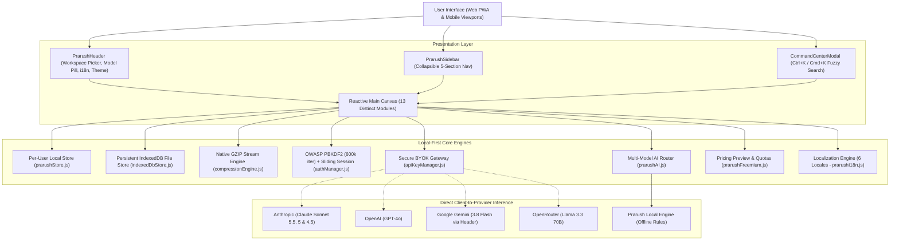

# ⚡ PRARUSH — Local-First Workspace for Developers & Creators

[-06b6d4.svg?style=flat-square)](https://github.com/Pratham4908/Prarush)
[](https://github.com/Pratham4908/Prarush)
[](https://github.com/Pratham4908/Prarush)
[](https://github.com/Pratham4908/Prarush)
[](https://github.com/Pratham4908/Prarush)

> **Prarush is a local-first workspace for software engineers and technical creators. It unifies fast idea capture, Kanban sprint boards, markdown notes, persistent document storage, real GZIP stream compression, visual automations, and direct multi-model AI inference into one fluid, private canvas.**

---

## 🎯 Target Audience & Core Workflow

**Primary Audience:** Software engineers, full-stack developers, technical researchers, and digital creators.

**Core Workflow:**
```
1. Quick Capture (Spec / Bug / Idea) 
       ⬇
2. Convert to Kanban Sprint Task (Priority, Deadline, Tags)
       ⬇
3. Implement with AI Copilot (BYOK Claude Sonnet 5.5, Sonnet 5 & 4.5, GPT-4o, Gemini 3.8 Flash, Llama 3.3, or Offline Rules)
       ⬇
4. Save Artifacts & Markdown Notes locally in private IndexedDB & LocalStorage
```

The default workspace opens directly to **Software Engineering & Dev** with engineering tasks, code templates, and developer notes.

---

## 🧭 Honest Product Status: Shipped vs. Production Roadmap

Prarush is transparent about what currently runs locally in the browser versus what is planned for backend cloud deployment:

### ✅ Currently Shipped & Working (Local-First Prototype)
- **Local-First Storage & Strict Profile Isolation:** Workspaces, Kanban tasks, markdown notes, calendar events, documents, and automations persist in client-side storage (`prarushStore.js`) strictly scoped per user ID, with zero fallback to shared keys or data leakage.
- **Client-Side Auth & Sliding Session Expiry:** OWASP-recommended PBKDF2 password key derivation (600,000 iterations, HMAC-SHA256, Web Crypto API) with legacy migration and zero plaintext password storage (`authManager.js`). Sessions implement a sliding 30-day inactivity expiration window refreshed upon active platform usage.
- **Direct Multi-Model AI Routing (BYOK):**
  - **Anthropic Claude Sonnet 5.5 (`claude-sonnet-5-5`), Sonnet 5 (`claude-sonnet-5`) & Sonnet 4.5 (`claude-sonnet-4-5`):** Direct browser-to-API inference via official Anthropic Messages API (`x-api-key`). 1M context window (128K max output) for Sonnet 5.5 and Sonnet 5 (marked legacy).
  - **OpenAI GPT-4o:** Direct inference via Chat Completions API (`Authorization: Bearer`).
  - **Google Gemini 3.8 Flash (`gemini-3.8-flash`):** Direct inference via REST API using standard `x-goog-api-key` header (never exposing API keys in URL query strings).
  - **OpenRouter (Meta Llama 3.3 70B):** Direct gateway access for open-weights models.
  - **Prarush Local Engine:** Deterministic offline rule generator for code structures, presentations, and task templates when no API key is configured.
  - **Real Error Reporting:** Live provider failures report actual error messages and explicitly announce fallback to local offline rules.
  - **Session-Only Key Storage & Purge:** BYOK keys default to `sessionStorage` (purged on tab close) with 1-click "Purge All Keys" capability.
- **Persistent Binary Storage (IndexedDB):** Uploaded files (`.pdf`, images, `.txt`, `.md`, `.json`, `.csv`) persist in browser IndexedDB (`prarush_files_db`) with owner scoping across reloads and sessions. Real byte sizes are tracked against browser storage quotas.
- **Authentic GZIP Stream Compression:** Files are compressed using the browser's native `CompressionStream('gzip')`, calculating actual byte reduction and providing downloadable `.gz` binary archives for actual uploaded files.
- **Keyword & Passage Retrieval:** Keyword-matched lexical search across stored notes, documents, and references. Accurately extracts matching passages and returns an explicit no-match response when no terms match, without artificial confidence scores.
- **Data Portability, Complete ZIP Backup & Restore:** Machine-readable JSON metadata export, complete backup archive (.ZIP bundling metadata, document manifest, and IndexedDB binary files) with collision-proof filename deduplication, archive safety limits (50 MB compressed, 500 max entries, 100 MB uncompressed limit), and an interactive restore engine with validation preview, legacy data claim, and conflict handling.
- **Smart Command Center:** Global `Ctrl+K` / `Cmd+K` natural language fuzzy search palette.
- **Internationalization:** Localization across 6 global languages (English, Spanish, French, Japanese, German, Hindi).
- **Mobile Packaging Dependencies:** Capacitor dependencies (`@capacitor/core`, `@capacitor/cli`, `@capacitor/android`, `@capacitor/ios`) integrated into `package.json`.

### ⏳ Planned Production Backend Services (Roadmap)
- **Cloud Database Synchronization:** Multi-device synchronization via PostgreSQL / Supabase with Row-Level Security (RLS).
- **Verified Server Billing:** Stripe checkout, webhook entitlement verification, and subscription management before activating paid tiers.
- **Server-Side OCR Microservice:** Optical character recognition microservice for complex scanned binary PDFs and images.
- **Native Store Releases:** Compiling native Android and iOS store binaries with device testing.

---

## 🏗️ System Architecture



---

## 🧪 Automated Verification Suite

Prarush includes an automated test runner (`src/test-prarush.js`) validating the entire local-first architecture:

```bash
# Run Prarush Verification Suite
node src/test-prarush.js
```

**Verified Test Cases:**
- Default workspace defaults to `ws-work` (Software Engineering & Dev)
- Session expiry enforcement in `getCurrentUser()`
- Direct AI model routing (Claude never routes to OpenAI; Gemini uses header auth)
- Accurate labeling of offline fallbacks
- User data isolation per account
- Authentic binary file preservation and download
- Keyword passage search and genuine no-match handling
- Origin-safe storage purge targeting only `prarush_*` keys

---

## 💻 Local Development & Production Build

```bash
# 1. Install dependencies
npm install

# 2. Run automated engine tests
node src/test-prarush.js

# 3. Start local Vite development server
npm run dev

# 4. Compile optimized production bundle
npm run build

# 5. Preview production bundle locally
npm run preview
```

---

## 🔒 Privacy & Legal Disclosures

- **Privacy Notice:** [`public/privacy.html`](public/privacy.html) — Accurately documents local browser storage and direct BYOK provider connections.
- **Terms of Service:** [`public/terms.html`](public/terms.html) — Details prototype status and free usage with disabled checkout.

---

*Engineered with precision for independent developers and technical creators.*
